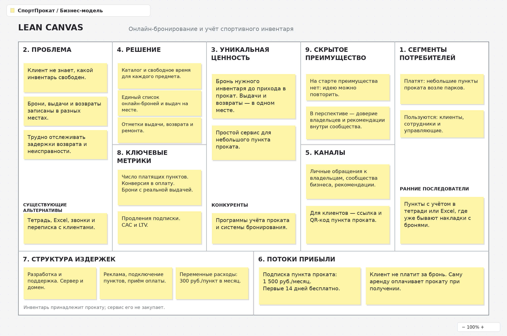
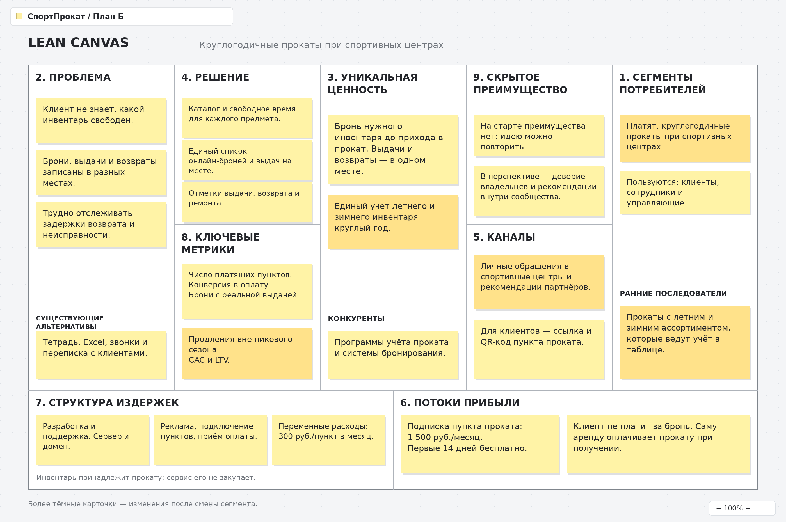
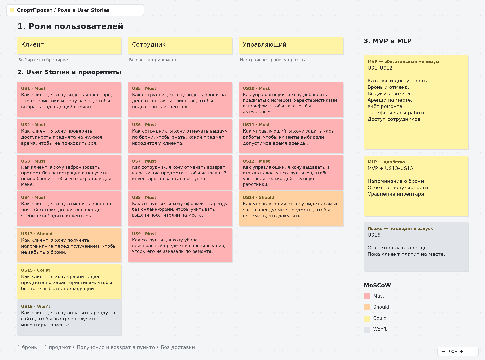

# СпортПрокат — сервис аренды спортивного инвентаря

Бизнес-модель: B2B. Пункт проката оплачивает подписку на сервис. Клиенты бронируют инвентарь через сайт без дополнительной платы, а саму аренду оплачивают в пункте проката при получении.

# Задание 1

1. Elevator Pitch

Клиент приходит в прокат за велосипедом, а свободных уже нет. Сотрудник записывает брони в тетрадь, отвечает на звонки и может забыть отметить возврат. Я предлагаю «СпортПрокат» — сервис для небольших пунктов проката велосипедов, самокатов, лыж и коньков. Клиент сможет заранее выбрать предмет, проверить свободное время и оформить бронь без регистрации. Главная особенность — единый учёт онлайн-броней, выдач на месте и возвратов. Это поможет сотрудникам избежать двойных бронирований, а клиентам — не приходить зря. Пункт проката платит за сервис 1 500 рублей в месяц, первые 14 дней бесплатны. Комиссии с аренды нет. Предлагаю владельцам небольших прокатов попробовать сервис на своём инвентаре.

2. Lean Canvas

# Задание 2

1. HADI-гипотеза

Самый критичный риск — риск ценности: управляющему может хватать тетради или Excel, поэтому он не захочет платить за сервис. Он связан с блоками «Проблема», «Уникальная ценность» и «Потоки прибыли» в Lean Canvas.

* **H (гипотеза):** Если небольшим пунктам проката предложить онлайн-бронирование с единым учётом выдач и возвратов, то минимум 2 из 8 пунктов за 14 дней получат хотя бы по 5 броней, завершившихся выдачей инвентаря, и оплатят следующий месяц за 1 500 рублей.
* **A (действие):** Найти 8 пунктов с учётом в тетради или таблице и провести пилот в их рабочий сезон. Для каждого сделать страницу с инвентарём, форму заявки и общую таблицу. Заявки сверять и подтверждать вручную; сотрудники отмечают все выдачи и возвраты, в том числе без онлайн-брони. Пункты разместят ссылку в своих соцсетях. На странице будет указано, что бронь действует после подтверждения. Через 14 дней предложить платное продолжение. Участники знают, что это ручной пилот.
* **D (данные):** Посчитать заявки, подтверждённые брони, реальные выдачи по ним и оплаты следующего месяца для каждого пункта. Конверсия в оплату = число оплативших пунктов / 8 × 100%. У отказавшихся узнать причину.
* **I (выводы):** Гипотеза предварительно подтверждена, если минимум 2 пункта получат по 5 выдач по онлайн-броням и оплатят продолжение. Если таких пунктов меньше 2, выяснить причину: мало заявок, неудобный учёт или цена. После пилота нужно проверить продление подписки. Это план эксперимента, а не уже полученные результаты.

В рабочем MVP подтверждение доступного инвентаря будет автоматическим. Ручной пилот нужен для проверки спроса до разработки.

2. Расчет базовой Юнит-экономики

Юнит — один платящий пункт проката. Все числа ниже — учебные предположения. Это отдельная расчётная воронка, а не результаты пилота с 8 пунктами.

Воронка привлечения и расчёт CAC (Customer Acquisition Cost):

* Рекламный бюджет: 20 000 руб.
* Стоимость перехода по рекламе (CPC): 50 руб. Получаем 20 000 / 50 = 400 переходов.
* Конверсия в начало пробного периода: 20%. Получаем 400 × 0,20 = 80 пунктов проката. Рекламная стоимость одного подключения: 20 000 / 80 = 250 руб.
* Конверсия пробного периода в оплату: 25%. Получаем 80 × 0,25 = 20 платящих пунктов. Общая конверсия переходов в оплату: 20 / 400 × 100% = 5%.
* Переговоры и первоначальное подключение: ещё 10 000 руб., включая оценку своего времени.
* **CAC = (20 000 + 10 000) / 20 = 1 500 руб.** Один платящий пункт обходится в 1 500 рублей.

Расчёт LTV (Lifetime Value):

* Стоимость подписки: 1 500 руб./мес.
* Переменные расходы на обслуживание, поддержку и приём оплаты: 300 руб./мес. на пункт.
* Маржинальный доход с одного пункта: 1 500 − 300 = 1 200 руб./мес.

Предположим, что за всё время сотрудничества пункт оплатит 6 месяцев. Из-за сезонности они могут идти с перерывами.

**LTV = 1 200 руб. × 6 месяцев = 7 200 руб.**

**LTV / CAC = 7 200 / 1 500 = 4,8.**

Показатель выше ориентировочного порога 3. После привлечения остаётся 7 200 − 1 500 = 5 700 рублей на покрытие постоянных расходов и прибыль. Окупаемость привлечения по маржинальному доходу: 1 500 / 1 200 = 1,25 оплаченного месяца; календарный срок может быть больше из-за перерывов.

Вывод

При заданных предположениях экономика одного пункта сходится. Но это ещё не чистая прибыль проекта: нужно покрыть разработку и постоянные расходы. Основной риск — сезонность и короткий срок оплаты. Если пункт оплатит только один месяц, его LTV составит 1 200 рублей и не покроет CAC в 1 500 рублей.

3. Pivot

Если сезонные пункты быстро отключаются, можно сменить целевой сегмент на круглогодичные прокаты при спортивных центрах. Это **Customer Segment Pivot**. Бизнес-модель остаётся B2B, стоимость подписки — 1 500 руб./мес.

Для проверки проведу 14-дневный пилот с 5 такими прокатами. Если хотя бы 2 оплатят следующие 2 месяца, продолжу проверять удержание и пересчитаю CAC и LTV по фактическим данным. Круглогодичная работа сама по себе не гарантирует продления подписки.

Elevator Pitch:

Прокаты при спортивных центрах летом выдают велосипеды и самокаты, а зимой — лыжи и коньки. При смене сезона сотрудникам приходится обновлять ассортимент и следить за разными видами инвентаря. Я предлагаю «СпортПрокат» — сервис с единым каталогом, онлайн-бронированием и учётом выдач и возвратов. Клиент выбирает предмет на свободное время, а сотрудник видит его бронь рядом с выдачами, оформленными на месте. Неисправный инвентарь можно временно убрать из бронирования. В результате у проката будет одна система учёта для летнего и зимнего сезона. Подписка стоит 1 500 рублей в месяц; клиент не платит за бронь и оплачивает аренду при получении. Предлагаю спортивным центрам попробовать сервис бесплатно 14 дней.

Lean Canvas

# Задание 3

Первые 3 пункта задания представлены на рисунке: роли пользователей, 16 User Stories с приоритизацией по MoSCoW и состав MVP/MLP. Красные карточки — Must, оранжевые — Should, жёлтые — Could, серые — Won’t в текущем запуске. Справа показано разделение по версиям.

Роли: **клиент, сотрудник проката и управляющий**. В первой версии один аккаунт организации соответствует одному пункту. Одна бронь — один конкретный предмет на целое число часов в пределах рабочего дня; получение и возврат происходят на месте. Эти роли и сценарии подходят как исходному сегменту, так и варианту после Pivot.

Детализирование требований:

1. Бронирование инвентаря клиентом (US3)

Функциональные требования:

* Система должна позволять выбрать конкретный предмет с уникальным инвентарным номером, дату, начало и конец аренды с шагом 1 час.
* Интервал должен находиться в пределах рабочего дня пункта. Начало не может быть в прошлом, а конец должен быть позже начала.
* До подтверждения система должна показывать тариф за час и итоговую стоимость: тариф × число часов. Стоимость фиксируется при создании брони.
* Для брони обязательны имя длиной 1–50 символов и телефон: 10–15 цифр после удаления пробелов, скобок и дефисов, с необязательным «+» в начале. При ошибке система должна указать поле и не создавать бронь.
* При подтверждении система должна повторно проверить доступность. Пересечение с действующей бронью, ремонт или незавершённая выдача запрещают новую бронь. Из одновременных пересекающихся заявок на один предмет может быть принята только одна.
* После сохранения клиент должен получить номер брони, сведения о предмете, срок, стоимость и личную ссылку отмены. Бронь должна появиться у сотрудника. Повторная отправка той же заявки не должна создавать дубликат.

Аренда оплачивается в пункте при получении. Дополнительной платы за бронирование через сайт нет.

Нефункциональные требования:

* При 100 одновременных пользователях и 10 000 бронях в базе сервер должен обрабатывать 95% запросов бронирования не дольше 2 секунд, без учёта задержки сети клиента.
* Форма должна работать на экранах шириной 360–1 440 пикселей без горизонтальной прокрутки.
* Передача данных должна идти по HTTPS. Личная ссылка должна содержать случайный токен не менее 128 бит и открывать доступ только к одной брони.
* Публичный каталог и его API не должны раскрывать имена и телефоны клиентов из других броней.
* Подтверждение должно выдаваться только после сохранения брони в постоянной базе. Подтверждённые брони должны сохраняться после перезапуска сервиса.

2. Возврат инвентаря сотрудником (US7)

Функциональные требования:

* Система должна позволять сотруднику найти незавершённую выдачу по номеру брони или инвентарному номеру предмета.
* При возврате сотрудник должен выбирать состояние «Исправен» или «Нужен ремонт». Во втором случае обязателен комментарий о неисправности.
* Система должна сохранить фактическое время возврата, сотрудника и состояние предмета, затем закрыть выдачу.
* Исправный предмет должен снова стать доступен в свободные интервалы с учётом следующих броней. Неисправный предмет должен оставаться недоступным до снятия отметки о ремонте сотрудником или управляющим.
* Истечение срока аренды не должно заменять фактический возврат. Просроченная выдача должна выделяться в списке.
* Если задержка или ремонт затрагивают следующую бронь, система должна показать сотруднику предупреждение и контакты клиента для согласования замены или отмены.

Нефункциональные требования:

* Отмечать возврат должны только авторизованные сотрудник и управляющий своего пункта. У клиентов и работников других пунктов доступа быть не должно.
* При 100 одновременных пользователях и 10 000 бронях в базе сервер должен сохранять 95% возвратов не дольше 2 секунд.
* Закрытие выдачи и изменение состояния предмета должны сохраняться вместе. При сбое оба изменения должны отменяться.
* Подтверждённые возвраты должны сохраняться после перезапуска сервиса.
* Повторное подтверждение одного возврата не должно создавать дубликат или повторно менять состояние предмета.
